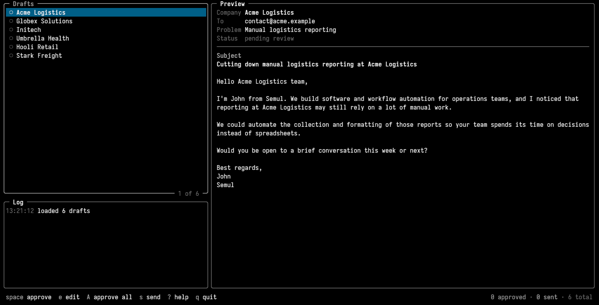

<p align="center">
  
</p>

<h1 align="center">semul</h1>

<p align="center">
  Semul is a simple tui tool for automating drafting and sending of emails to potential prospects
</p>

<p align="center">
  
</p>

#### How to use it

1. Reads prospects from a CSV
2. Skips anyone you've already contacted (SQLite)
3. Drafts an email per prospect with [Ollama](https://ollama.com) (`llama3.2`)
4. Lets you approve and edit drafts in a TUI
5. Sends approved emails over SMTP, one at a time

#### Setup

**Requirements:** Go, a C compiler (for SQLite), and Ollama running with the model pulled:

```sh
ollama pull llama3.2 # or any model of your choice
```

**Credentials:** create a `.env` file (use a Gmail [app password](https://myaccount.google.com/apppasswords)):

```env
SMTP_USERNAME=you@gmail.com
SMTP_PASSWORD="xxxx xxxx xxxx xxxx"
# SMTP_FROM=optional, defaults to SMTP_USERNAME
```

**Prospects:** a CSV with exactly these three columns:

```csv
company,email,identified_problems
Acme Logistics,hello@acme.com,Manual logistics reporting
```

## Run

```sh
go run ./cmd/semul prospects.csv
```

The sender name and company are set in `cmd/semul/main.go`.

## Keys

| Key | Action |
| --- | --- |
| `j` / `k` | move |
| `space` | approve / unapprove |
| `A` | approve all |
| `e` | edit (resets approval) |
| `s` | send approved |
| `?` | help |
| `q` | quit |

## Test

```sh
go test ./...
RUN_OLLAMA_TESTS=1 go test ./internal/batch   # needs Ollama
```
